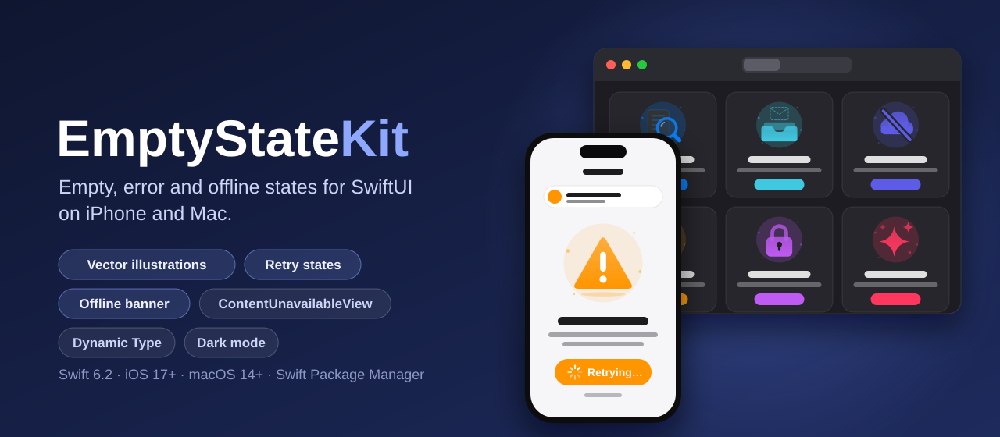
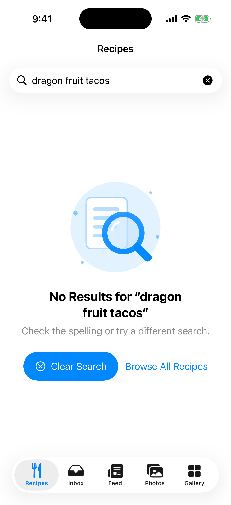
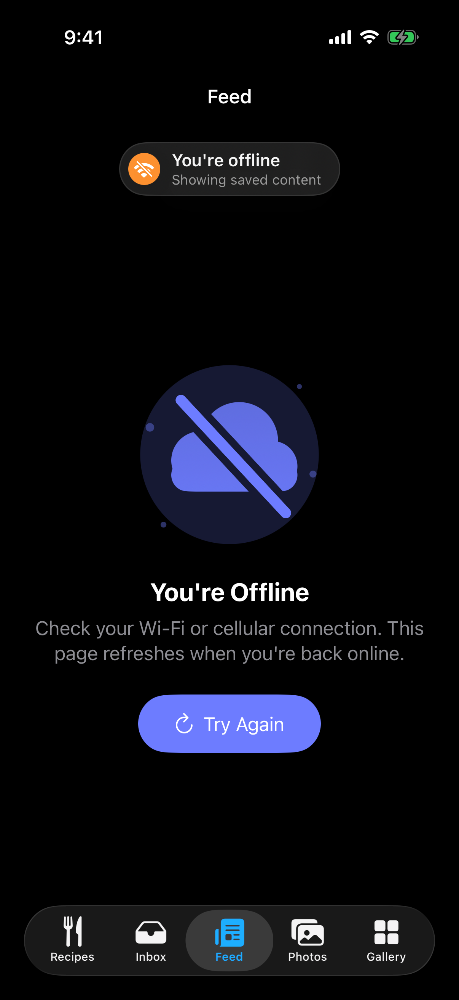
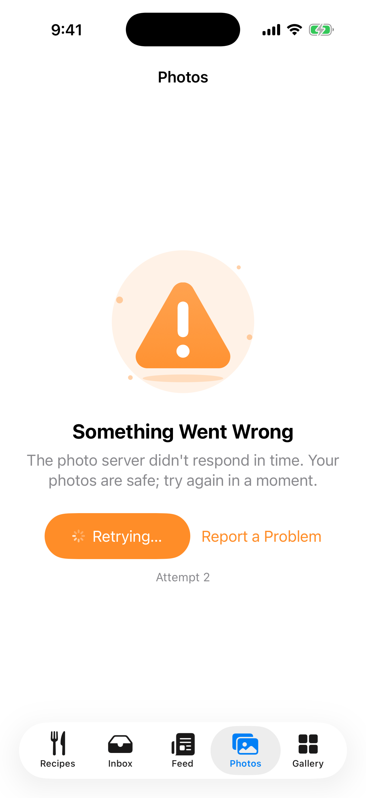
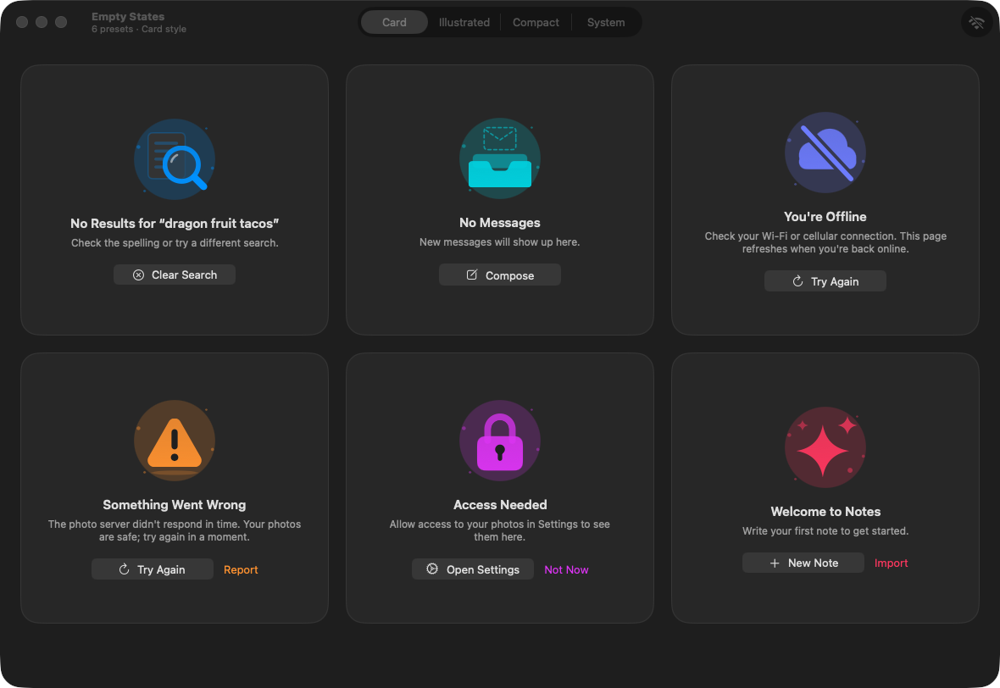

<p align="center">
  
</p>

<p align="center">
  <a href="https://github.com/halilozel1903/EmptyStateKit/actions/workflows/ci.yml"></a>
  
  
  
  
  
  <a href="LICENSE"></a>
</p>

**EmptyStateKit** gives SwiftUI apps on **iPhone and Mac** the screens nobody designs until the last week: no results, an empty inbox, offline, an error, missing permission and the first run. Each comes with a **vector illustration drawn in SwiftUI shapes** (no image assets, no emoji) that takes your tint and adapts to dark mode, sensible text you can replace, and **primary, secondary and retry buttons** whose async work shows a spinner, a *Retrying…* state, the attempt count and the last failure. Show them with **`.emptyState(when:)`**, as the system's **`ContentUnavailableView`**, or in four built-in **styles**; add a **network-aware offline banner** backed by `NWPathMonitor`. Dynamic Type, VoiceOver and Swift 6 strict concurrency included, with no dependencies.

```swift
import EmptyStateKit
import SwiftUI

struct RecipesView: View {
    @State private var query = ""
    @State private var network = NetworkMonitor()
    let model: RecipesModel

    var body: some View {
        NavigationStack {
            List(model.results(for: query)) { RecipeRow(recipe: $0) }
                .emptyState(
                    when: model.results(for: query).isEmpty,
                    .noResults(for: query)
                        .primaryAction("Clear Search") { query = "" }
                )
                .searchable(text: $query)
                .offlineBanner(network)
        }
    }
}
```

## Screenshots

Captured by CI from the example app on an iPhone simulator and on the Mac. EmptyStateKit is a UI library, so the screens show its views over the example app's **bundled demo content**: demo recipes, a demo feed and a demo photo service. The offline scene uses a **simulated** `NetworkMonitor` (the CI machine is online), and the error scene's demo service fails on purpose so the second retry is captured while it runs.

| No results | Offline (dark mode) | Error, retrying |
| :---: | :---: | :---: |
|  |  |  |



## Features

- **Six presets**: `.noResults(for:)`, `.emptyInbox`, `.offline`, `.error(_:)`, `.noPermission(to:)` and `.firstRun(title:message:)`, each with an illustration, a tint, an SF Symbol and default English text. `.failure(error)` picks offline for connection errors (`URLError.notConnectedToInternet` and friends, also when wrapped) and an error state for anything else, showing a `LocalizedError`'s description and recovery suggestion.
- **Vector illustrations**: a magnifier over a page, an empty tray under the outline of a letter, a cloud with a slash, a rounded warning triangle, a padlock and sparkles, all built from SwiftUI `Shape`s on a soft backdrop. They scale to any size, use the state's tint, switch their paper and marks for dark mode and are hidden from VoiceOver. `.systemImage("…")` puts any SF Symbol on the same backdrop.
- **Actions with async state**: `primaryAction`, `secondaryAction` and `retryAction` take `async throws` closures. A running action shows a spinner and ignores further taps. The retry action runs through a `RetryController` that shows *Retrying…*, counts attempts ("Attempt 2"), keeps a short failure line under the buttons ("You're still offline.") and announces it to VoiceOver. A fast failure still shows the spinner for a moment, so nothing flickers.
- **`.emptyState(when:)`**: shows the state over any view (a `List`, a grid, a scroll view) and hides that view, also from VoiceOver, while navigation titles, toolbars and the search field stay. Variants take a collection or your own view.
- **`ContentUnavailableView` interop**: `ContentUnavailableView(.noResults(for: query))` builds the system view from any content, with working buttons, and the `.contentUnavailable` style renders every `EmptyStateView` that way. `.illustratedContentUnavailable` puts the drawn illustration in the system layout.
- **Styles**: `.illustrated` (the default: large and centred, scrolls when text is huge), `.compact` (beside the text, for list sections and sidebars), `.card` (for grids and dashboards), `.contentUnavailable` and your own `EmptyStateStyle`, set with `.emptyStateStyle(_:)` for a whole hierarchy.
- **Network-aware offline banner**: `NetworkMonitor` wraps `NWPathMonitor` and publishes connectivity, interface, cost and Low Data Mode on the main actor. `.offlineBanner(monitor)` slides in a *You're offline* capsule, then *Back online* for a moment when the connection returns; `.onNetworkReconnect(monitor) { … }` reloads what failed. `NetworkMonitor.simulated(.offline)` drives previews, tests and demos.
- **Dynamic Type and dark mode**: illustrations grow with the text size, then shrink at the accessibility sizes to leave room; buttons sit side by side when they fit and stack otherwise; the compact style turns vertical at the accessibility sizes. Every color adapts to light and dark mode.
- **iPhone and Mac**: the same views on iOS 17+ and macOS 14+. `EmptyStateAction.openSettings()` opens the app's page in Settings on iPhone and Privacy & Security on the Mac.
- **Tested**: presets, error mapping, action order, the retry controller (overlapping retries, cancellation, minimum duration), network status mapping, the banner's states and the illustration geometry are covered with Swift Testing on macOS and an iOS simulator.

## API

| Type | What it is |
| --- | --- |
| `EmptyStateView` | Shows an `EmptyStateContent` in the current style. `init(_:retry:)`, or `init(_ title:message:illustration:tint:actions:retry:)` |
| `EmptyStateContent` | Title, message, illustration, SF Symbol, tint and actions. Presets: `.noResults(for:)`, `.emptyInbox`, `.offline`, `.error(_:)`, `.noPermission(to:)`, `.firstRun(title:message:)`, `.failure(_:)`. Builders: `title(_:)`, `message(_:)`, `illustration(_:)`, `systemImage(_:)`, `tint(_:)`, `primaryAction`, `secondaryAction`, `retryAction`, `action(_:)` |
| `EmptyStatePreset` | The six presets with their `title`, `message`, `illustration`, `systemImage`, `tint` and `name` |
| `EmptyStateAction` | A button: `.primary`, `.secondary`, `.retry`, `.openSettings()`; `kind`, `title`, `systemImage`, `progressTitle`, `perform` |
| `RetryController` | `@Observable` retry state: `phase` (`.idle`, `.retrying(attempt:)`, `.failed(attempt:message:)`, `.succeeded(attempt:)`), `attempts`, `isRetrying`, `failureMessage`, `retry(_:)`, `reset()`, `minimumDuration` |
| `EmptyStateIllustration` | `.magnifier`, `.tray`, `.cloudOffline`, `.warning`, `.lock`, `.sparkles`, `.systemImage(_:)`, `.none` |
| `EmptyStateIllustrationView` | Draws an illustration on its backdrop in a tint, for your own layouts |
| `EmptyStateStyle` | `.illustrated`, `.illustrated(size:)`, `.compact`, `.card`, `.contentUnavailable`, `.illustratedContentUnavailable`, or your own; `EmptyStateStyleConfiguration` gives `illustration`, `title`, `message`, `actions`, `actionButtons(layout:)` |
| `EmptyStateActionsView` | The buttons with their states, `.automatic`, `.vertical` or `.horizontal` |
| `emptyState(when:_:retry:)`, `emptyState(for:_:retry:)`, `emptyState(when:placeholder:)` | Show a state over a view while it is empty |
| `emptyStateStyle(_:)` | Set the style for a hierarchy |
| `ContentUnavailableView(_:retry:)` | The system view from an `EmptyStateContent` |
| `NetworkMonitor` | `@Observable` `NWPathMonitor` wrapper: `status`, `isOnline`, `isOffline`, `init(requiring:)`, `.simulated(_:)`, `simulate(_:)` |
| `NetworkStatus` | `connectivity` (`.unknown`, `.online`, `.offline`, `.requiresConnection`), `interface`, `isExpensive`, `isConstrained` |
| `offlineBanner(_:edge:backOnlineDuration:)`, `OfflineBanner` | The offline and back-online banner |
| `onNetworkReconnect(_:perform:)` | Runs an action when the connection comes back |

## Installation

In Xcode choose **File › Add Package Dependencies…** and enter:

```
https://github.com/halilozel1903/EmptyStateKit
```

Or add it to `Package.swift`:

```swift
dependencies: [
    .package(url: "https://github.com/halilozel1903/EmptyStateKit", from: "1.0.0")
],
targets: [
    .target(name: "MyApp", dependencies: [
        .product(name: "EmptyStateKit", package: "EmptyStateKit"),
    ])
]
```

## Usage

### Presets and custom states

```swift
EmptyStateView(.emptyInbox)

EmptyStateView(
    .noPermission(to: "your photos")
        .action(.openSettings())
        .secondaryAction("Not Now") { dismiss() }
)

EmptyStateView(
    .firstRun(title: "No Notes Yet", message: "Write your first note to get started.")
        .primaryAction("New Note", systemImage: "plus") { await notes.create() }
)

// Your own state, with a drawn illustration or any SF Symbol on the same backdrop.
EmptyStateView(
    "No Downloads",
    message: "Episodes you download appear here.",
    illustration: .systemImage("arrow.down.circle"),
    tint: .green
)

// Change any part of a preset.
EmptyStateView(.offline.title("No Connection").tint(.gray))
```

### Errors and retrying

```swift
struct PhotosView: View {
    @State private var model = PhotosModel()

    var body: some View {
        PhotoGrid(photos: model.photos)
            .emptyState(when: model.photos.isEmpty && model.error != nil,
                .failure(model.error!)                 // offline for connection errors, error otherwise
                    .retryAction { try await model.load() }
                    .secondaryAction("Report a Problem") { model.report() }
            )
    }
}
```

While the retry runs, the button reads *Retrying…* with a spinner; from the second attempt "Attempt 2" appears under it, and when it throws, the error's description does. Errors thrown by primary and secondary actions are left to you.

To start retries from elsewhere, or keep the count while the view is recreated, keep the `RetryController` yourself:

```swift
@State private var retry = RetryController()

EmptyStateView(.failure(error).retryAction { try await model.load() }, retry: retry)
    .refreshable { await retry.retry { try await model.load() } }

retry.phase          // .idle, .retrying(attempt: 2), .failed(attempt: 1, message: "…"), .succeeded(attempt: 3)
retry.reset()
```

### The `.emptyState(when:)` modifier

```swift
List(messages) { MessageRow(message: $0) }
    .emptyState(for: messages, .emptyInbox.primaryAction("Compose") { compose() })

ScrollView { Grid(items) }
    .emptyState(when: items.isEmpty) {
        MyCustomPlaceholder()           // any view
    }
```

The content stays in the hierarchy, faded out and hidden from VoiceOver, so its navigation title, toolbar and `searchable` field keep working.

### ContentUnavailableView

```swift
// The system view, built from any content, with working buttons.
ContentUnavailableView(.noResults(for: query))

// Every EmptyStateView inside, rendered as ContentUnavailableView.
SidebarView()
    .emptyStateStyle(.contentUnavailable)

// The system layout with the drawn illustration instead of the SF Symbol.
    .emptyStateStyle(.illustratedContentUnavailable)
```

### Styles

```swift
EmptyStateView(.emptyInbox)
    .emptyStateStyle(.compact)              // illustration beside the text, for list sections

LazyVGrid(columns: columns) {
    EmptyStateView(.firstRun())
}
.emptyStateStyle(.card)                     // a rounded card

.emptyStateStyle(.illustrated(size: 220))   // a larger illustration
```

Write your own from the configuration's parts, so the buttons keep their states:

```swift
struct BannerStyle: EmptyStateStyle {
    @MainActor func makeBody(configuration: Configuration) -> some View {
        HStack(spacing: 12) {
            configuration.illustration.frame(width: 44, height: 44)
            configuration.title.font(.headline)
            Spacer()
            configuration.actionButtons(layout: .horizontal).controlSize(.small)
        }
        .padding()
    }
}
```

### Offline banner and reconnecting

```swift
@main
struct MyApp: App {
    @State private var network = NetworkMonitor()

    var body: some Scene {
        WindowGroup {
            ContentView()
                .offlineBanner(network)                         // "You're offline", then "Back online"
                .onNetworkReconnect(network) { await store.reload() }
                .environment(network)
        }
    }
}

network.status.connectivity     // .unknown, .online, .offline, .requiresConnection
network.status.interface        // .wifi, .cellular, .wiredEthernet, …
network.status.isExpensive      // cellular or a hotspot
network.status.isConstrained    // Low Data Mode

// Previews and tests
let offline = NetworkMonitor.simulated(.offline)
offline.simulate(.online)
```

## Example app

The `Example` folder contains *Empty States*, built with EmptyStateKit, using bundled demo content only:

- **iPhone**: a recipe search (try any text that matches none of the nine demo recipes), an inbox whose Compose button adds demo messages, a feed that loads only while the network monitor reports a connection and shows the offline banner, a photo library whose demo server fails twice before it works, and a gallery of every preset with a style picker.
- **Mac**: every preset in a grid of cards, a toolbar picker for the card, illustrated, compact and system styles, and a *Simulate Offline* switch that shows the banner.

The project uses [XcodeGen](https://github.com/yonaskolb/XcodeGen) so no project file has to live in the repo:

```bash
brew install xcodegen
cd Example && xcodegen generate
open EmptyStateKitDemo.xcodeproj
```

Run `StatesPhone` on an iPhone simulator and `StatesMac` on the Mac. Launch with `-screenshot no-results|offline|error` (iPhone) or `-screenshot gallery` (Mac) to open the scene CI captures.

## Requirements

- Xcode 26 or later (Swift 6.2 toolchain)
- iOS 17+ or macOS 14+

## Contributing

Issues and pull requests are welcome. Please run the tests before opening a PR:

```bash
swift test
bash scripts/test.sh iOS
```

## License

EmptyStateKit is available under the MIT license. See [LICENSE](LICENSE).
